# FleetFlow Admin Guide

This guide covers all administrative capabilities and workflows in FleetFlow for administrators (`ADMIN` role).

---

## 1. Dashboard & Operational KPIs
The Admin Dashboard provides real-time statistics across fleet size, active drivers, current bookings, and financial performance.

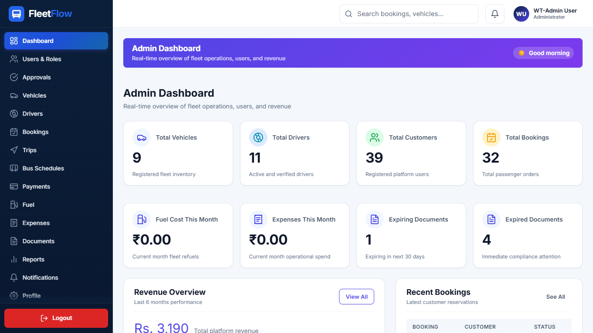

### Key Metrics
- **Total Vehicles**: Live count of active, maintenance, and retired fleet items.
- **Active Drivers**: Licensed drivers available for dispatch.
- **Bookings & Schedules**: Real-time count of customer bookings awaiting approval or assigned.
- **Revenue & Utilization**: Financial summaries and fleet utilization rates.

---

## 2. User Management & Permissions
Administrators have complete control over user roles, approvals, and activation status.

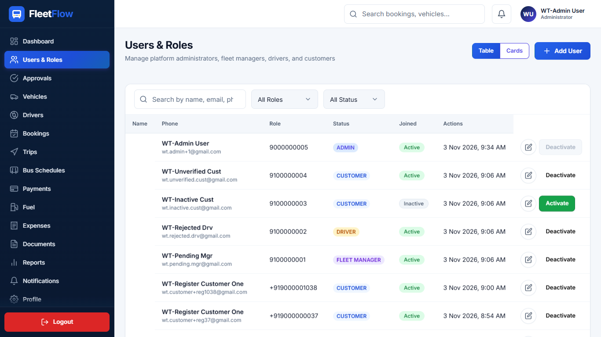

### Guidelines
1. **Adding Users**: Create accounts for Drivers, Fleet Managers, or Customers directly from the admin panel.
2. **Deactivation & Security**: Deactivate compromised or inactive accounts instantly. Note: An administrator cannot deactivate their own account.
3. **Role Assignments**: Seamlessly transition users between roles (e.g., Fleet Manager to Admin).

---

## 3. Account Approvals & Onboarding
New registrations for privileged roles (Fleet Managers and Drivers) require explicit administrator approval before they can access dashboard capabilities.

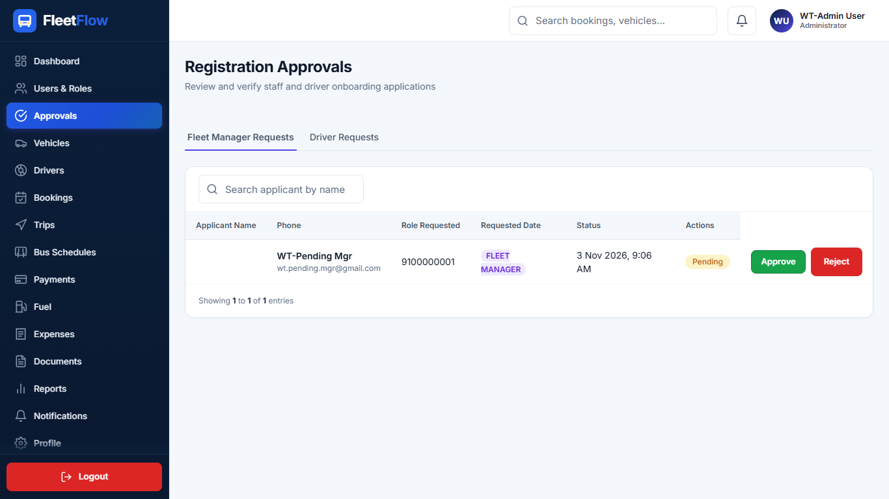

- **Reviewing Documents**: Inspect driver licenses and managerial credentials.
- **Approval Flow**: Approving sends an automated confirmation notification and email.
- **Rejection Flow**: Rejections require a mandatory reason, notifying the applicant immediately.

---

## 4. Vehicle & Fleet Management
Track and manage all vehicles across CAR, BIKE, and BUS types.

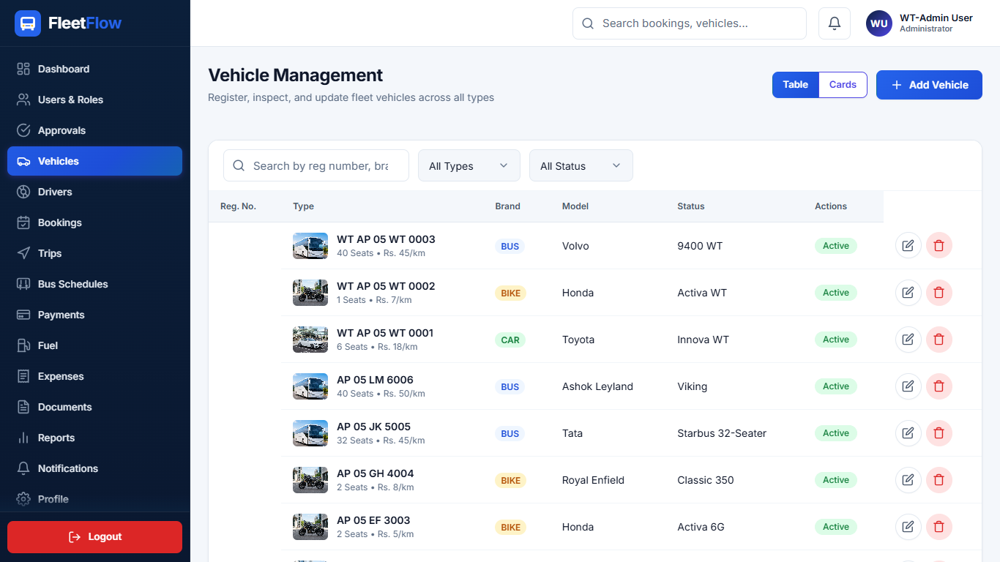

- Add new vehicles with registration numbers, seating capacities, and per-kilometer rates.
- Maintain status flags: `ACTIVE`, `MAINTENANCE`, `RETIRED`.

---

## 5. Driver Management
View driver license details, expiration deadlines, and assignable statuses.

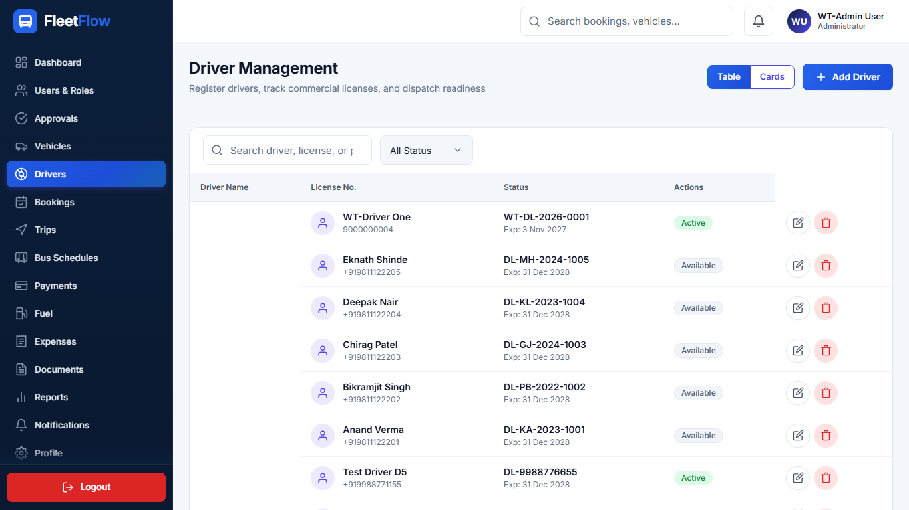

---

## 6. Bookings & Trip Tracking
Inspect all customer booking requests and supervise scheduled and active trips across the system.

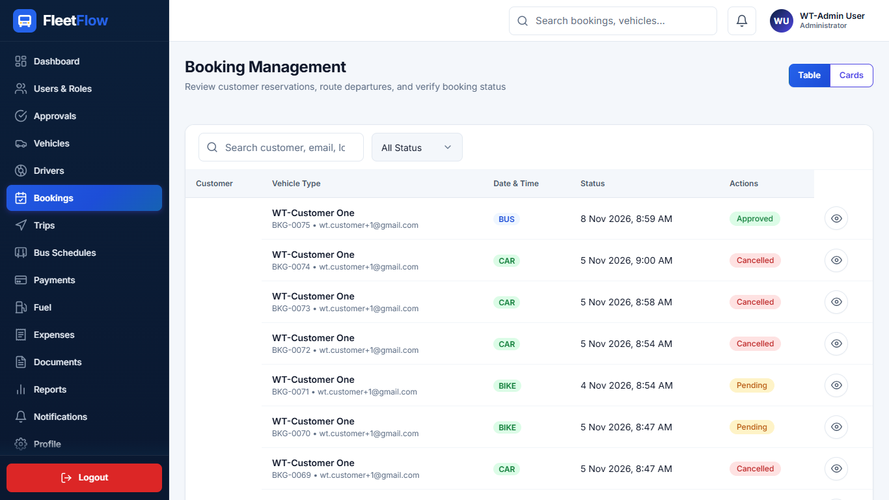

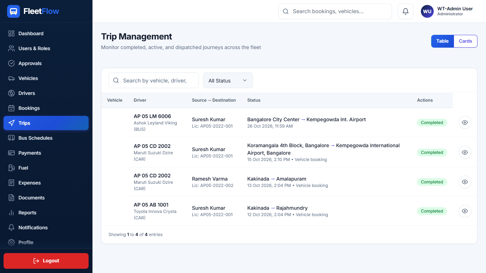

---

## 7. Bus Schedules & Seat Allocation
Configure fixed-route bus schedules, departure times, and seat fares.

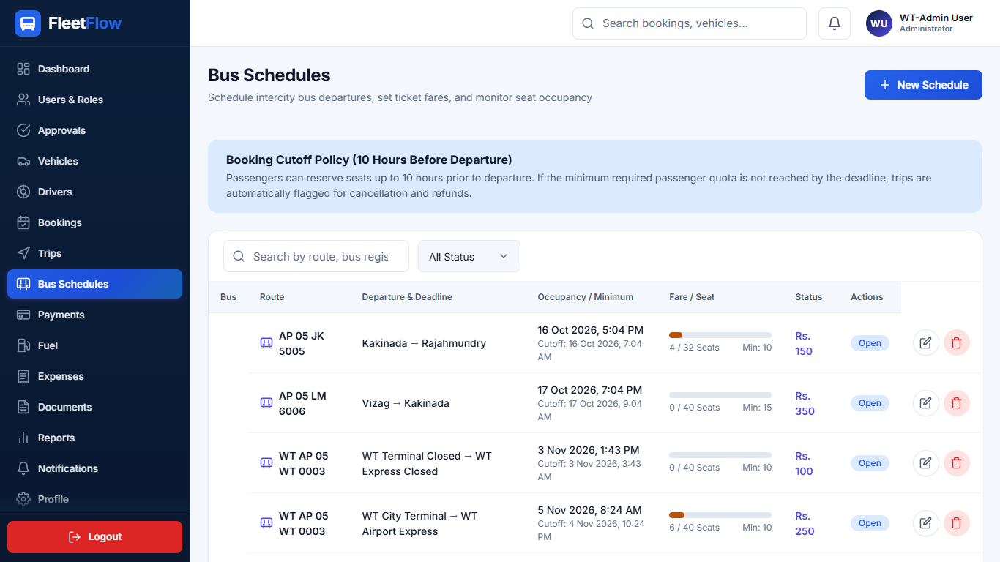

---

## 8. Payments, Proof Verification & Refunds
Review customer payment proofs, approve verified transactions, and track pending refunds.

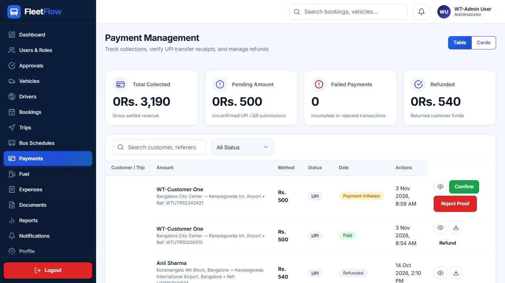

---

## 9. Fuel & Compliance Documents Review
Fleet managers and administrators review driver-submitted fuel refill logs and vehicle/driver compliance documents:
- Drivers enter fuel entries and upload compliance papers directly from their portal.
- Admin and Manager inspect submissions under the **Pending** review tabs, examine receipts/documents, and approve or reject with clear feedback.
- Fleet metrics, reports, and vehicle cost dashboards count only approved records.

---

## 10. Reports & System Settings
Access monthly revenue charts, trip summaries, and configure global system settings.

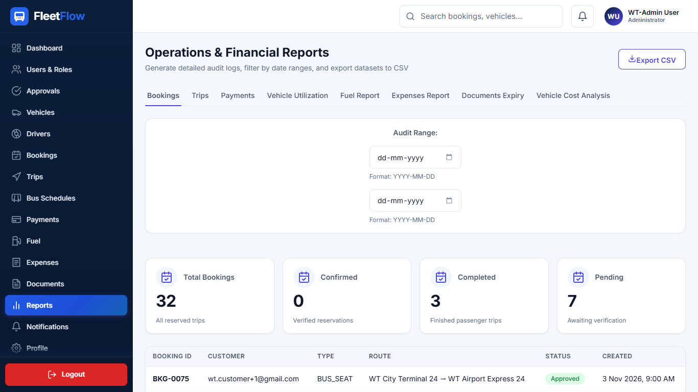

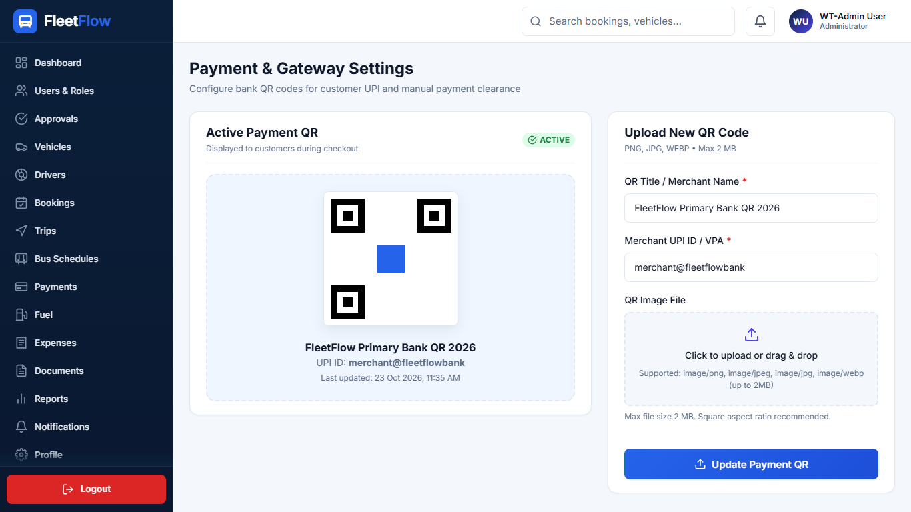

