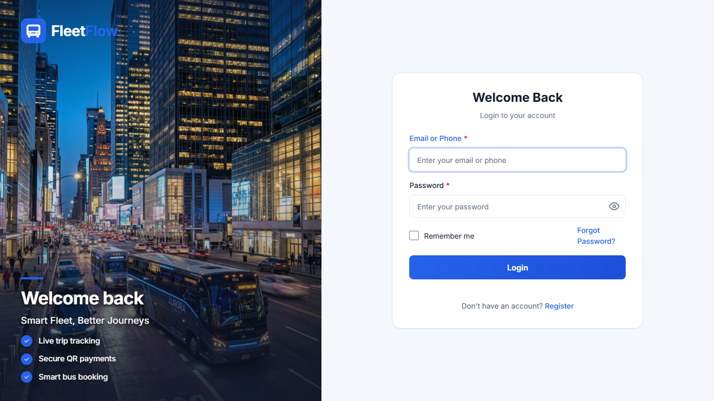
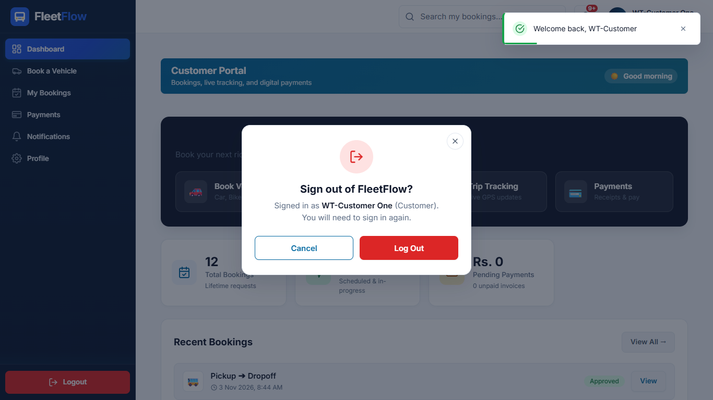
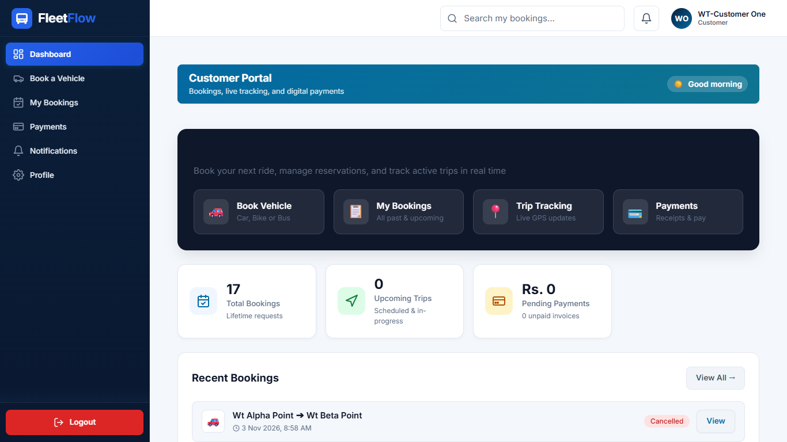
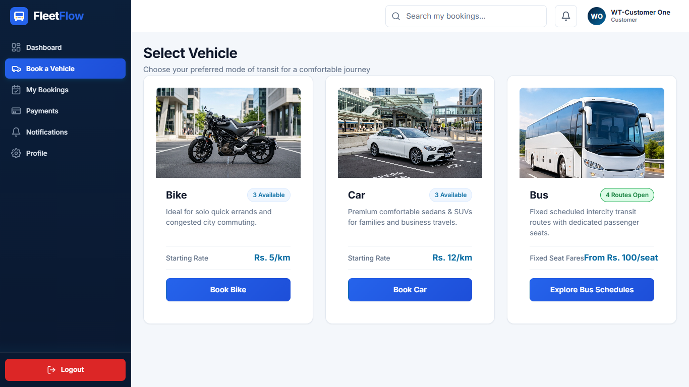
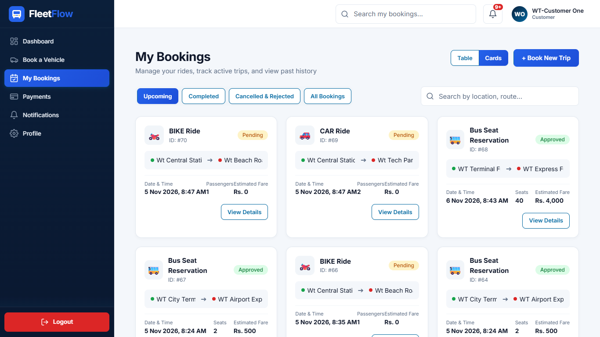
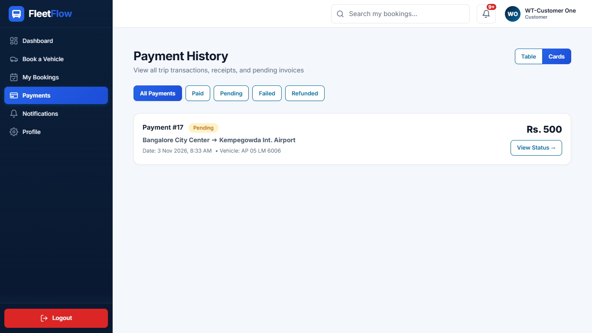
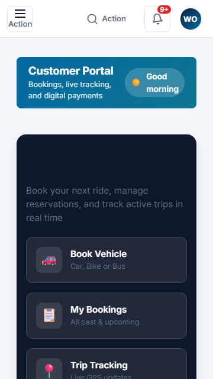

# FleetFlow - Customer User Guide

Welcome to the FleetFlow Customer portal. This guide walks you through every feature, booking rule, and payment process available to customer accounts.

---

## 1. What a Customer Can and Cannot Do

### What You CAN Do:
- **Register & Authenticate:** Register with email and 10-digit phone, verify email via 6-digit OTP, securely log in, and reset forgotten passwords.
- **Book Vehicles:** Book Cars and Bikes on demand with instant fare estimates based on distance and vehicle type rate.
- **Reserve Bus Seats:** Search open bus routes, view available seats, and reserve seats before the 10-hour departure deadline.
- **Track Bookings:** View live statuses across your bookings (Pending, Confirmed, On Trip, Completed, Cancelled).
- **Pay via QR & UPI:** View the active bank QR code, copy the UPI ID, enter your transaction reference (UTR), upload screenshot proof via multipart form, and download PDF receipts.
- **Profile & Settings:** Update your full name and contact information, change your password, and monitor notifications.

### What You CANNOT Do:
- Access admin, fleet manager, or driver pages (protected by role-based guards; returns 403 Forbidden).
- View or manipulate other customers' bookings, payments, or personal data (object-level permissions isolate customer data, returning 404 Not Found).
- Directly assign drivers or vehicles to trips.
- Book a bus schedule within 10 hours of departure or once all seats are reserved.

---

## 2. Account Registration, Login & Session Management

### Step 1: Registration
1. Navigate to `http://localhost:3000/register`.
2. Fill in:
   - **Full Name:** Your complete legal name.
   - **Email:** A valid email address (disposable domains are blocked).
   - **Phone Number:** Exactly 10 digits starting with 6, 7, 8, or 9.
   - **Role:** Select **Customer**.
   - **Password:** Minimum 6 characters.
3. Click **Register Account**.

### Step 2: Email OTP Verification
- A 6-digit one-time password (OTP) is sent to your registered email.
- Enter the 6 digits on `/verify-otp`.
- If an incorrect OTP is entered, remaining attempts are shown.
- Click **Verify Account**. If expired, click **Resend OTP** (rate-limited for security).

### Step 3: Sign In
1. Navigate to `/login`.
2. Enter your registered email or phone in the identifier field and your password.
3. Check **Remember me** if you wish to persist your session across browser restarts.
4. Click **Sign In**.

### Step 4: Sign Out
- Click the **Logout** button in the sidebar footer.
- The dedicated **Logout Dialog** will open, showing your logged-in name and role.
- Click **Log Out** to cleanly revoke tokens and redirect to the sign-in page.

---

## 3. Customer Dashboard Explained

The Customer Dashboard provides an instant real-time snapshot of your transport activity:

| Element / Card | Description | Data Source / Calculation | On Click Action |
| :--- | :--- | :--- | :--- |
| **Greeting Strip** | Dynamic greeting (Morning / Afternoon / Evening) with your name and role badge | Local time and `authContext.user` | Displays current active shift and system time |
| **Total Bookings** | Counter of all bookings placed under your account | `GET /api/dashboard/customer/` | Quick overview of your booking history |
| **Active Trips** | Number of ongoing trips currently marked `ON_TRIP` | Filtered bookings where status is `ON_TRIP` | Highlights trips available for live tracking |
| **Completed Trips** | Total number of successfully completed journeys | Bookings with status `COMPLETED` | Displays overall completed ride milestones |
| **Total Spent** | Total sum in rupees paid across completed trips | Aggregated sum of `PAID` payments | Financial summary of your transport spend |
| **Recent Activity List** | Tabular list of your latest 5 bookings with route and status badges | `GET /api/bookings/?limit=5` | Links directly to booking details |

---

## 4. Sidebar Pages Overview

| Page Link | Path | Purpose | Key Actions Available |
| :--- | :--- | :--- | :--- |
| **Dashboard** | `/customer/dashboard` | Central activity and transport overview | View statistics, track ongoing rides |
| **Book Ride** | `/customer/book` | Book on-demand Cars, Bikes or Bus seats | Select vehicle type, enter locations, confirm reservation |
| **My Bookings** | `/customer/bookings` | View and filter all past and upcoming trips | Filter by status (Pending, Confirmed, Cancelled), cancel ride |
| **Payments** | `/customer/payments` | Pay ride invoices, submit transaction proof | View QR code, submit transaction reference, download receipt PDF |
| **Notifications** | `/customer/notifications`| Notification bell and alert center | Read booking status updates and payment receipts |
| **Profile** | `/customer/profile` | Personal details and security settings | Update profile, change password |

---

## 5. Step-by-Step How-To Tasks

### Task 1: Book a Car or Bike (On-Demand)
1. Open **Book Ride** (`/customer/book`).
2. Choose **Car** or **Bike**. (Bikes enforce a strict 1 passenger maximum).
3. Enter your **Pickup Location** (e.g., `Central Station`) and **Drop Location** (e.g., `Tech Park`).
4. Select the **Travel Date & Time** (must be in the future).
5. Specify number of **Passengers**.
6. View the calculated **Estimated Fare** (Distance in km $\times$ Vehicle rate per km).
7. Click **Confirm Booking**. The booking status starts as `PENDING` awaiting fleet manager review.

### Task 2: Reserve a Bus Seat
1. On `/customer/book`, toggle to the **Bus Booking** tab.
2. Select your desired bus schedule from the open departures list.
3. Review available seats, seat fare, and the 10-hour departure cutoff timer.
4. Enter passenger count (must not exceed remaining available seats).
5. Click **Reserve Seats**. Your reservation is instantly confirmed and assigned to the bus schedule.

### Task 3: Cancel a Pending Booking
1. Navigate to **My Bookings** (`/customer/bookings`).
2. Locate your booking in the `Pending` or `Confirmed` tab.
3. Click **Cancel Booking**.
4. Provide a cancellation reason in the modal prompt.
5. Click **Confirm Cancellation**. The booking transitions to `CANCELLED` and any allocated vehicle/seat is immediately released.

### Task 4: Pay via Bank QR Code & Submit Proof
1. Open **Payments** (`/customer/payments`).
2. Locate your unpaid booking.
3. Scan the official **FleetFlow Bank QR Code** or copy the official **UPI ID**.
4. Complete the transfer in your UPI or banking application.
5. Enter the **Transaction Reference (UTR)** (6 to 30 alphanumeric characters).
6. (Optional) Attach a payment screenshot image (`.png`, `.jpg`, max 2 MB).
7. Click **Submit Proof**. The status updates to `PAYMENT_INITIATED` while awaiting driver or manager verification.
8. Once verified, download your official **PDF Tax Receipt**.

---

## 6. Business Rules & Tips

- **10-Hour Bus Deadline:** Bus schedules automatically lock seat reservations 10 hours before departure.
- **Minimum Bus Passengers:** If a scheduled bus fails to meet the minimum required passenger threshold before the deadline, the trip is cancelled, and you will receive options for an alternative bus, rebooking, or a full refund.
- **Accurate UTR Numbers:** Always provide the exact transaction reference from your banking app. Duplicate or invalid format references are automatically rejected.
- **Strict Data Isolation:** Customers cannot view other customer records; accessing unowned IDs returns a clean `404 Not Found`. Attempting to access administrative or manager views returns `403 Forbidden`.
- **Mobile Friendly:** The entire booking, tracking, and payment interface is fully optimized for mobile screens (360px) and desktops (1366px).

